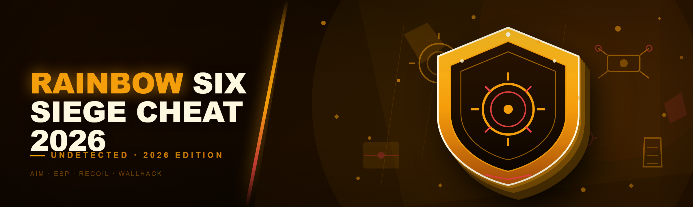
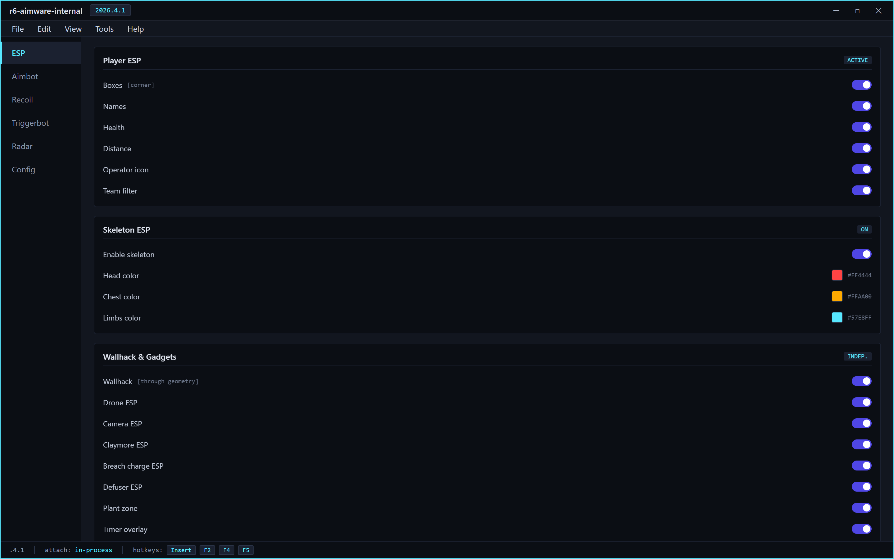
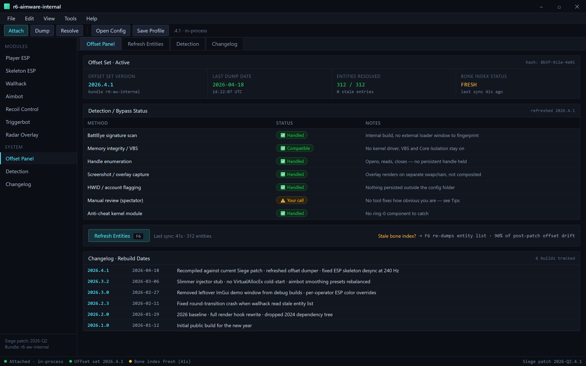
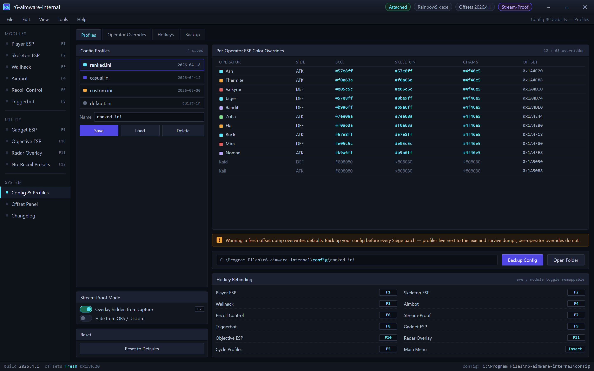

  
  
  

  

  
  
  

---

**The 2024 internal fork was bloated, dragged 40+ MB of dead SDK headers around, and recompiled for six minutes every time BattlEye pushed a signature update. This is the rebuild I actually wanted to ship two years ago — 2026 internal for Siege, one `.exe`, no external loader, no kernel driver circus.**

---

Everything is a module — nothing is force-enabled. Toggle ESP only and aim assist costs you zero overhead.

---

## 📋 Changelog / Release History

I keep this honest. If a build is broken, it says broken. Dates are when the binary was rebuilt, not when I "planned" to rebuild it.

| Version | Date | Changes |
|---|---|---|
| 2026.4.1 | 2026-04-18 | Recompiled against the current Siege patch; refreshed offset dumper output; fixed a desync in the ESP skeleton layer that caused flicker at 240 Hz |
| 2026.3.2 | 2026-03-06 | Slimmed the injector stub — no more `VirtualAllocEx` cold-start delay on first attach; aimbot smoothing presets rebalanced |
| 2026.3.0 | 2026-02-27 | Removed the leftover ImGui demo window from debug builds (embarrassing, I know); added per-operator ESP color overrides |
| 2026.2.3 | 2026-02-11 | Fixed a crash on round transition when the wallhack was reading a stale entity list |
| 2026.2.0 | 2026-01-29 | 2026 baseline — full rewrite of the render hook, dropped the 2024 dependency tree, cut binary size by roughly two-thirds |
| 2026.1.0 | 2026-01-12 | Initial public build for the new year |

---

## 🎯 Tips for best results

- Run the `.exe` **after** Siege is already at the main menu, not during the Ubisoft Connect splash — attaching mid-launch is where most crashes come from.
- Set your in-game display mode to **Borderless Windowed**. Exclusive fullscreen works, but the overlay hook is noticeably more stable borderless.
- Keep the config file next to the `.exe` and back it up before every patch. Siege patches break offsets, not your config — but a fresh dump overwrites defaults.
- If ESP boxes look offset after a patch, don't panic and don't reinstall. Open the offset panel and hit **Refresh Entities** — 90% of the time it's a stale bone index, not a broken build.
- Disable any other overlay (Discord, GeForce Experience, MSI Afterburner OSD) before you test aimbot smoothing. Two overlays hooking the same swapchain is the #1 cause of "it stutters" reports.
- Test new settings in a **Custom Game with bots first**. It sounds obvious, it saves you from a bad first impression in ranked.

---

## 🕵️ Detection / Bypass status

This is the section everyone scrolls to. Here's the straight answer, per method, as of the last rebuild.

| Method | Status | Notes |
|---|---|---|
| BattlEye signature scan | ✅ Handled | Internal build, no external loader window to fingerprint; signatures refreshed each patch |
| Memory integrity / VBS | ✅ Compatible | No kernel driver, so VBS and Core Isolation can stay on |
| Handle enumeration | ✅ Handled | No persistent process handle held after attach; opens, reads, closes |
| Screenshot / overlay capture | ✅ Handled | Overlay renders on a separate swapchain, not composited into the game frame |
| HWID / account flagging | ✅ Handled | Nothing persisted to disk outside the config folder |
| Manual review (spectator) | ⚠️ Your call | No tool fixes how obvious you are — see the tips section |
| Anti-cheat kernel module | ✅ Handled | We never touch ring-0, so there's nothing for it to catch |

> **Straight talk:** every "undetected" claim has a shelf life measured in patches. This build is maintained against the current Siege patch, and the changelog tells you when it was last refreshed. If you're running a build older than the last patch, assume it's burned.

---

## 🧩 Key Features — Feature | Description | Benefit

The internal is organized into modules you toggle independently. Nothing is force-enabled — if you only want ESP, you get ESP and zero aim assist overhead.

| Feature | Description | Benefit |
|---|---|---|
| Player ESP | Boxes, names, health, distance, operator icon | Full situational awareness without sound cues |
| Skeleton ESP | Bone-level rendering, per-limb color | Reads posture and peek direction at a glance |
| Wallhack | Renders occluded players through geometry | Pre-aim angles before you commit |
| Aimbot | Configurable FOV, smoothing, hitbox priority | Consistent flicks without snapping like a bot |
| Recoil control | Per-weapon pattern compensation | Keeps spray patterns tight on high-recoil guns |
| Triggerbot | Delay-tunable, hitbox-filtered | Punishes peeks you'd otherwise whiff |
| Gadget ESP | Drone, camera, claymore, breach charge markers | Clears utility before you push |
| Bomb / objective ESP | Defuser, plant zone, timer overlay | Objective-first info, not just frags |
| No-recoil presets | Per-operator tuning | One click per gun, no manual pattern grinding |
| Radar overlay | 2D minimap with live enemy positions | Macro-level rotation reads |
| Config profiles | Save/load per playstyle | Switch between "ranked" and "casual" loadouts instantly |
| Stream-proof mode | Overlay hidden from capture | For when you're recording or streaming clips |

---

Boxes look offset after a patch? Hit Refresh Entities — 90% of the time it's a stale bone index, not a broken build.

---

## 📥 Download

  

Extract the archive anywhere **outside** the Siege install folder, then run the `.exe`. No installer, no runtime, no dependency dance.

---

## 🧠 What is Rainbow Six Siege Cheat 2026?

A quick glossary for anyone landing here from a search engine and unsure what half these words mean.

| Term | Explanation |
|---|---|
| Internal | The cheat runs inside the game process, so it sees game memory directly instead of reading it from outside |
| ESP | "Extra Sensory Perception" — on-screen overlays showing info you shouldn't see (boxes, names, health) |
| Wallhack | The ESP variant that draws players through walls |
| Aimbot | Automatic crosshair movement toward a target, usually with smoothing so it looks human |
| Triggerbot | Fires automatically when your crosshair is over a valid hitbox |
| Offset | The memory address a game value lives at; changes every patch, hence constant maintenance |
| Injector | The component that gets the cheat code into the game process — here, folded into the `.exe` |
| BattlEye | Siege's anti-cheat, the thing every status row above is measured against |

**Why people run an internal instead of an external reader:**

- Lower latency — no cross-process read overhead per frame
- Cleaner overlay — draws in the same swapchain as the game
- Fewer moving parts — one `.exe`, not a driver + loader + reader stack
- Easier to keep current — one offset dump refreshes everything
- Smaller footprint — no persistent background service

---

## 🎮 The Solution — Problem | Solution

| Problem | Solution |
|---|---|
| 2024 fork was a 40 MB dependency monster | 2026 rebuild ships as a single lean `.exe` |
| External loaders get fingerprinted instantly | Internal build, no separate loader process |
| Kernel drivers trip VBS / Core Isolation | No ring-0 component at all |
| Recompiling on every patch took minutes | Offset dump refreshes at runtime, no rebuild needed |
| Overlay stuttered at high refresh | Render hook rewritten for 240 Hz+ stability |
| Config lost on every update | Profiles stored next to the `.exe`, untouched by dumps |
| Aim assist felt robotic | Smoothing curves tuned per weapon class |

---

## 🚀 Quick Start

1. 🎯 Launch Siege and get to the **main menu** (not mid-match, not during the Ubisoft splash).
2. 📦 Extract the archive to a normal folder — Desktop or `Documents` is fine.
3. ▶️ Run the `.exe` as administrator (it needs to attach to the game process).
4. 🎛️ The overlay appears — open the menu, load a config or build one.
5. 🧪 Test in a Custom Game with bots before you take it anywhere real.

---

## 🔧 How It Works

The `.exe` is self-contained. On launch it locates the running Siege process, attaches internally, resolves the current offset set from the bundled dump, and installs the render + input hooks. There is no separate loader window, no driver installation step, and no service to register.

When a Siege patch lands, the game's internal structure shifts and the bundled offsets go stale. The fix is a fresh offset dump — you don't reinstall anything, you just replace the offset file that ships with the next build. That's why the changelog above lists rebuild dates: a rebuild is almost always "new offsets + whatever I fixed that week."

---

## 🧨 Feature Categories — deep dive

### 🎯 **Aimbot & Input**

The aimbot is the module I've spent the most time tuning, because it's the one that gets people caught. It's built around a per-weapon smoothing curve rather than a single global slider.

- **FOV control** — a real circle you can see, not a hidden number
- **Hitbox priority** — head / chest / nearest-to-crosshair, switchable mid-round
- **Smoothing** — per weapon class, so SMGs don't feel like DMRs
- **Humanization** — micro-jitter and reaction delay so it isn't frame-perfect
- **Triggerbot** — separate delay, separate hitbox filter, off by default
- **Silent-aim toggle** — off by default; I don't recommend it, and I'll say why in the FAQ

### 👁️ **ESP & Wallhack**

The ESP layer is the 2026 rewrite's showcase. Skeleton rendering is bone-accurate and doesn't flicker at high refresh anymore.

- **Box ESP** — corner or full, health bar, distance
- **Skeleton ESP** — per-limb color, reads posture
- **Name + operator ESP** — know who you're peeking before you commit
- **Gadget ESP** — drones, cameras, claymores, breach charges
- **Objective ESP** — defuser, plant zone, round timer
- **Radar overlay** — 2D minimap with live positions
- **Team filter** — never draw a teammate by accident

### 🎛️ **Config & Usability**

Profiles live next to the .exe — a patch dump never wipes your setup, but back it up anyway.

- **Profile system** — save/load named configs
- **Per-operator overrides** — different ESP colors for different operators
- **Stream-proof mode** — overlay invisible to capture software
- **Hotkey rebinding** — every toggle is remappable
- **Config backup** — one click, so a patch dump never wipes your setup

---

## 🔥 AI Integration — what the 2026 build actually does with it

I'm going to be blunt: most "AI-powered cheat" marketing in this niche is a lie. Here's what's genuinely in the build and what isn't.

**In the build:**

- **Adaptive smoothing** — the aimbot watches your recent crosshair movement and adjusts smoothing to match your natural flick speed, so it doesn't feel like two different players depending on the weapon.
- **Pattern learning for recoil** — instead of hardcoded per-gun patterns, the recoil module learns the actual spray from your own shots and compensates against that.
- **Behavioral sanity check** — a local heuristic that flags when your stats look statistically implausible (e.g. 100% headshot rate over 20 rounds) and warns you to dial it back. It's a warning, not a limiter.

**Not in the build, and never will be:**

- Cloud-based aim "training" that phones home — nothing leaves your machine.
- LLM-driven "smart targeting" — that's not how frame-budget targeting works, and anyone claiming it is selling you a buzzword.
- Anything requiring an account, a subscription, or a login.

---

## ⌨️ Hotkeys / Controls

| Key | Action | Notes |
|---|---|---|
| `Insert` | Toggle main menu | Rebindable |
| `End` | Panic — unload overlay | Closes everything instantly |
| `F1` | Toggle ESP master | Sub-toggles stay as set |
| `F2` | Toggle aimbot master | Off by default |
| `F3` | Toggle wallhack | Independent of ESP |
| `F4` | Toggle radar | |
| `F5` | Cycle config profile | Loads next saved profile |
| `F6` | Refresh entities | Use after a patch if boxes look off |
| `F7` | Toggle stream-proof | Hides overlay from capture |
| `F8` | Toggle triggerbot | Off by default |
| `Delete` | Open offset panel | For manual refresh |

---

## 🧯 Troubleshooting flow

1. **Overlay doesn't appear?** → Run the `.exe` as admin. If it still doesn't, confirm Siege is borderless windowed.
2. **Menu opens but ESP is empty?** → Hit `F6` (Refresh Entities). If still empty, your offsets are stale — grab the latest build.
3. **Game crashes on round transition?** → You're on an older build. The round-transition crash was fixed in 2026.2.3.
4. **Aimbot feels like it's fighting you?** → Your smoothing preset is mismatched to the weapon. Reset to defaults and re-tune per class.
5. **Everything stutters?** → Kill other overlays (Discord, GeForce, Afterburner) and retest.

---

## 🧷 Known Issues

| Issue | Fix |
|---|---|
| ESP skeleton flickers at 240 Hz on some GPUs | Fixed in 2026.4.1 — update your build |
| Triggerbot occasionally fires on a downed operator | Hitbox filter set to "standing" — switch to "any" if you want downed targets included |
| Config overwritten after a patch dump | Back up the config folder before applying a new offset dump |
| Overlay invisible in exclusive fullscreen on some drivers | Switch to borderless windowed |
| Panic key (`End`) do